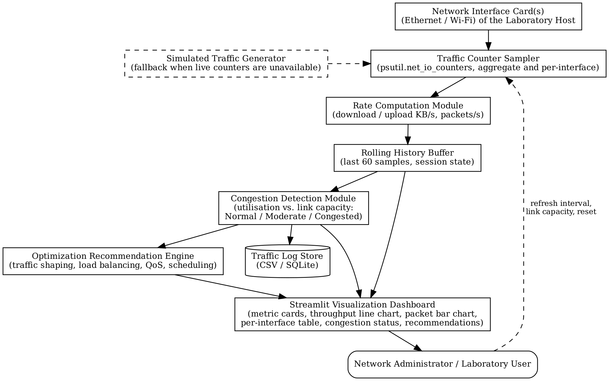

# Network Traffic Congestion Monitoring and Optimization Visualizer

A real-time dashboard that measures live network traffic, detects congestion and recommends optimization actions.

**Author:** Uwaegbulam Ugochi Racheal (HA24/0041)
**Project:** Design and Implementation of a Real-Time Network Traffic Congestion Monitoring and Optimization Visualizer (2026)

---

## Features

- **Live traffic capture**: reads byte and packet counters for all network interfaces using `psutil`.
- **Throughput and packet rates**: download and upload rates in KB/s and Mbps, plus packets per second.
- **Congestion detection**: compares link utilisation with a configurable link capacity and labels it **Normal**, **Moderate** or **Congested**. The default thresholds are 50% and 80%.
- **Optimization recommendations**: suggests actions such as traffic shaping, QoS priority, off-peak scheduling and load balancing, with a priority for each.
- **Visualization**: metric cards, a throughput chart, a utilisation chart with threshold lines, a packet-flow chart and a per-interface table.
- **Traffic log**: saves samples and recommendations to a SQLite database (`traffic_log.db`) and exports them as CSV.
- **Demo mode**: a labelled simulated traffic stream, with an optional heavy-load setting, for demonstrations. The app also switches to it automatically if live counters cannot be read.

## Architecture



| Module | Where in the code |
|---|---|
| Traffic Counter Sampler | `core.read_counters()`, `core.read_per_interface()` |
| Simulated Traffic Generator | `core.simulated_counters()` |
| Rate Computation Module | `core.compute_rates()` |
| Congestion Detection Module | `core.utilisation_percent()`, `core.classify()` |
| Optimization Recommendation Engine | `core.recommend()` |
| Traffic Log Store (SQLite) | `core.TrafficLog` |
| Visualization Dashboard | `app.py` (Streamlit) |

The process flowchart is in [`docs/flowchart.png`](docs/flowchart.png).

## Requirements

- Python 3.9 or later
- Windows 10/11, Linux or macOS
- Python packages: `streamlit`, `psutil` (listed in `requirements.txt`)

## Installation and running

```bash
git clone https://github.com/<your-username>/network-congestion-visualizer.git
cd network-congestion-visualizer
pip install -r requirements.txt
streamlit run app.py
```

The dashboard opens at **http://localhost:8501**.

Shortcut: on Windows, double-click **`start.bat`**. On Linux or macOS, run **`./start.sh`**.

## How to use

1. **Traffic source**: leave it on *Live (auto fallback)* to monitor real traffic. Choose *Simulated (demo)* and turn on *Simulate heavy load* to demonstrate the Moderate and Congested levels.
2. **Link capacity (Mbps)**: enter the bandwidth of the link you are monitoring, for example the laboratory internet link.
3. **Thresholds**: adjust the Moderate and Congested percentages if needed.
4. Read the **Congestion status** panel and the **Optimization recommendations**.
5. Use **Download traffic log (CSV)** to export the recorded samples for analysis.

## Running the tests

```bash
pip install pytest
python -m pytest -q
```

## Project structure

```
├── index.html          # Web edition for GitHub Pages (demo + replay)
├── app.py              # Streamlit dashboard (presentation layer)
├── core.py             # Sampling, rates, congestion detection, recommendations, SQLite log
├── tests/test_core.py  # Unit tests
├── evaluation/         # Controlled-traffic evaluation script
├── docs/               # Architecture diagram and flowchart
├── requirements.txt
├── start.bat / start.sh
└── LICENSE
```

## Screenshots

<!-- Add screenshots after running the app, e.g. docs/screenshot-dashboard.png -->

## Limitations

- The app measures the traffic of the computer it runs on. To monitor a whole laboratory network, run it on the gateway or on a computer connected to the main switch.
- Congestion is detected from throughput compared with link capacity. Latency and packet-loss measurement are planned as future work.

## License

MIT. See [LICENSE](LICENSE).

## Reproducing the evaluation

```bash
python evaluation/run_experiments.py
```

This generates TCP traffic at known rates (0, 400, 800 and 1,200 KB/s) over the loopback interface, measures it with the same engine the dashboard uses, and saves the results in `evaluation/out/` (about 3 minutes).

## Web edition (GitHub Pages)

`index.html` is a standalone web edition of the dashboard that runs in any browser with no installation. It uses the same congestion classification and recommendation rules as `core.py`, and offers two data sources:

- **Simulated (demo)**: browser-simulated traffic, with a heavy-load option that shows all three congestion levels.
- **Replay: recorded live test**: plays back the 90 samples the Python system recorded in the controlled live test.

Web pages cannot read a computer's network counters, so **live monitoring requires the Python app** (`streamlit run app.py`).

To publish: open the repository on GitHub → **Settings** → **Pages** → under *Build and deployment* choose **Deploy from a branch**, select branch **main** and folder **/(root)**, then **Save**. After a minute or two the dashboard is live at `https://<your-username>.github.io/network-congestion-visualizer/`.
